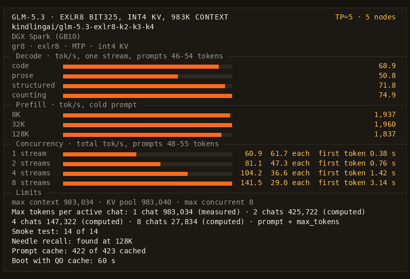

# KindlingAI: GLM-5.3 EXLR8 on five DGX Sparks (983K context)

If you are an agent booting this for someone, read [AGENTS.md](AGENTS.md) first, then the Quickstart.

_**Join our discord to learn more about KindlingAI and `gr8`: https://discord.gg/8EAvYPV2rE**_

Full GLM-5.3 on five DGX Sparks (GB10, 128 GB each) at TP=5, served by [gr8](https://github.com/kindlingai/gr8) `v1.1.0` from
the `bit325` width profile of [kindlingai/glm-5.3-exlr8-k2-k3-k4](https://huggingface.co/kindlingai/glm-5.3-exlr8-k2-k3-k4/tree/3e388b45b26ca4558351d22994afcfc85b99af74) (v0.6):
a 983,040-token int4 KV pool, MTP=3 drafting with confidence stopping, up to 8 concurrent chats, 8.8+ GiB free RAM per box,
and a QO cache for ~60 s boots. This recipe is the published gr8 image, pinned by digest, and one `.env` file. Nothing is compiled.



68.9 tok/s for one request writing code · 1,960 tok/s prefill on a 32K prompt (1,837 tok/s at 128K) · 8 requests at once, 141.5 tok/s in total (160.5 tok/s in fast mode) · 8.8+ GiB free memory per box · a 983,040-token KV pool · a fact hidden in a 128K prompt found · boot in 60 s

## Results

Five DGX Sparks on a 200G switch, TP=5, `gr8 v1.1.0` (`cdd1e09`), this recipe's `.env` (`bit325` v0.6 experts, int4 KV, MTP=3 with confidence stopping, quality default `MOE_UNION_CAP=48`), measured 2026-11-20 with gr8's own benchmark (`bench/bench.py`, default level), one fresh boot. GPU clocks were uncapped in the timed stages. Every speed is in tokens per second (tok/s).

One request, short prompts (46-54 tokens, up to 512 tokens out, 6 runs each):

| work | code | prose | structured | counting |
|---|---|---|---|---|
| tok/s, mean | 68.9 | 50.8 | 71.8 | 74.9 |
| lowest - highest run | 65.0 - 71.4 | 47.1 - 54.2 | 68.2 - 74.3 | 74.3 - 75.5 |
| 95% interval | 67.2 - 70.6 | 48.8 - 52.7 | 70.2 - 73.2 | 74.6 - 75.3 |

Prefill, cold prompt (one run each):

| prompt | first token | prefill tok/s | decode after it | first token, same prompt again (cached) |
|---|---|---|---|---|
| 8K tokens | 4.25 s | 1,937 | 48.0 tok/s | 0.07 s |
| 32K tokens | 16.74 s | 1,960 | 36.7 tok/s | 0.25 s |
| 128K tokens | 71.34 s | 1,837 | 36.4 tok/s | 0.46 s |

Requests at once (short mixed prompts, 48-55 tokens, up to 512 tokens out each):

| requests at once | 1 | 2 | 4 | 8 |
|---|---|---|---|---|
| total tok/s (quality default, `MOE_UNION_CAP=48`) | 60.9 | 81.1 | 104.2 | 141.5 |
| tok/s per request (quality default) | 61.7 | 47.3 | 36.6 | 29.0 |
| first token, median | 0.38 s | 0.76 s | 1.42 s | 3.14 s |

### Speed and quality presets (`MOE_UNION_CAP`)

`gr8 v1.1.0` enables seven bit-exact decode and prefill kernels (`KL = 0.00000`), `DEC_BK_MAX=2048` (raising free memory per box from 2.8 GiB to 8.8+ GiB even with a 33% larger KV pool and 8 sessions), and a batch-budgeted MoE expert union cap (`MOE_UNION_CAP`):

| preset (`.env`) | code decode | 4 streams total (per req) | 8 streams total (per req) | prefill 8K / 32K / 128K |
|---|---:|---:|---:|---:|
| **Quality (default, `MOE_UNION_CAP=48`)** | 68.9 tok/s | 104.2 (36.6) tok/s | 141.5 (29.0) tok/s | 1,937 / 1,960 / 1,837 tok/s |
| **Fast (`MOE_UNION_CAP=32`)** | 69.3 tok/s | 119.6 (42.2) tok/s | 160.5 (33.9) tok/s | 1,979 / 2,010 / 1,826 tok/s |
| **Uncapped exact (`MOE_UNION_CAP=0`)** | 69.2 tok/s | 89.5 (30.8) tok/s | 110.5 (18.5) tok/s | 1,986 / 2,059 / 1,855 tok/s |

All three presets were measured on fresh boots on 2026-11-20 (`bench/bench.py` default level for Quality and Uncapped exact, `--quick` for Fast, 0 suspect characters across all three runs).

### How long each chat can be

The KV pool holds 983,040 tokens (3,481 physical pages of 64 tokens per rank). The first 32,768 tokens (`SHARE_LIMIT`) of each chat are stored on every box, and the rest is spread across the five boxes. Each active chat reserves its prompt plus `max_tokens`:

| active chats | 1 | 2 | 3 | 4 | 8 |
|---|---:|---:|---:|---:|---:|
| tokens per chat, equal split | 983,034 | 425,722 | 240,122 | 147,322 | 27,834 |

The 1-chat value is measured (the served `max_model_len`); the multi-chat values are computed from the pool size (3,481 physical pages per rank). Up to 8 chats decode simultaneously (`SESS=8`). A finished chat's cached prefix does not count against active chats.

Checks on the same `v1.1.0` default boot:

| check | result |
|---|---|
| smoke test | 14 of 14 |
| fact hidden in a 131,270-token prompt | found |
| count to 200, three times | 3 of 3 clean |
| prompt cache | 422 of 423 cached |
| suspect characters | 0 replies |
| longest context (`max_model_len`) | 983,034 tokens |
| boot to `/health` 200 with the QO cache | 60 s (model already on disk) |
| lowest `MemAvailable` recorded on any box | 8.77 GiB after bench (9.30 - 9.43 GiB after boot) |

### Why `int4` KV preserves quality while unlocking a 983K-token pool

`KV_FORMAT=int4` is **mixed-precision**, not naive blanket 4-bit quantization — `gr8` compresses each part of the KV cache differently depending on its sensitivity:

- **RoPE positional keys (64 dims) stay full BF16 (128 B/tok)** — positional geometry is never 4-bit quantized.
- **Sparse-attention indexer keys (128 dims) stay FP8 E4M3 (132 B/tok)** — top-K sparse token retrieval stays sharp at long context.
- **Only the 512-dim MLA latent is stored in 4-bit**, after an orthonormal **512-point Sylvester Hadamard rotation** (`H x`) with **per-32-dim FP16 scales** (`288 B` vs `528 B` in FP8). The rotation spreads channel outliers across all 512 dims (+4–6 dB worst-case SQNR in layers 2–3), hitting **20.3 dB median SQNR at 416 B/row** (beating MXFP4 and matching NVFP4 in fewer bytes) while folding `H` directly into the decode weights (`KV4_FOLD=1`) for zero extra rotation overhead.
- **Measured quality:** Adds just **+0.010 KL** over FP8 on held-out text vs. BF16 (~6.5% of weight quantization's own KL), with **97.0%** top-1 agreement vs. FP8 (`KL=0.0145`), `qeval` **73/75 vs 74/75** (`p=1.0`), and 100% long-context needle recall. Set `KV_FORMAT=fp8` in `.env` anytime to roll back to FP8 KV. Full math and study: [gr8 KV4.md](https://github.com/kindlingai/gr8/blob/main/docs/KV4.md).

[kindling.json](kindling.json) has these numbers in a form a program can read. The card above is drawn from it.

## Quickstart

On every box, first turn off proactive memory compaction and open TCP ports 7340 and 7341 between the boxes
([What you need](#what-you-need)). Then, on every box:

```bash
git clone https://github.com/kindlingai/glm-5.3-exlr8-5x-spark && cd glm-5.3-exlr8-5x-spark
sudo mkdir -p /srv/gr8/cache/qocache && sudo chown -R 1000:1000 /srv/gr8/cache
cp .env.example .env
nano .env                  # PEERS: the five LAN addresses, head first. The same file on every box.
docker compose up -d       # pulls the pinned gr8 image; the first boot fetches this box's part of the model
docker compose logs -f     # this box's supervisor; ready when the cluster serves
```

The first boot also writes the QO cache (13 GB a box) to `/srv/gr8/cache/qocache`. Later boots read it (~60 s). The engine
does not make that directory: without the `mkdir` line no cache is written, and every boot takes the long time.
For another place, change `GR8_CACHE` in `.env` and make its `qocache` directory the same way.

Then, on the head (the first address in `PEERS`):

```bash
docker compose exec gr8 /opt/gr8/gr8 glm53 smoke
curl -s localhost:8100/v1/models      # max_model_len 983034
```

The head serves an OpenAI-compatible API on port 8100. Stop the cluster with
`docker compose exec gr8 /opt/gr8/gr8 glm53 down` on the head, then `docker compose down` on every box.

## What you need

- Five DGX Sparks or other GB10 boxes (128 GB unified memory), with nothing else holding much memory (8.8+ GiB free
  per box measured at `CAP=983,040`).
- A RoCE v2 fabric between the ConnectX-7 ports through one 200G switch. Five boxes do not work as a ring.
- A LAN between the boxes with TCP ports 7340 and 7341 open.
- Docker with the NVIDIA container toolkit (DGX OS has both).
- About 75 GB of disk a box for the model (`~59.9 GB` of experts on the busiest rank at TP=5) and 13 GB for the QO cache.
- Proactive memory compaction off on every box:
  `sudo sysctl -w vm.compaction_proactiveness=0` (gr8's
  [DEPLOY.md](https://github.com/kindlingai/gr8/blob/main/docs/DEPLOY.md#before-you-start) has the permanent form).

## The 983K-context settings

Every line is in [.env.example](.env.example). Highlights over the `v1.0` recipe:

- `gr8 v1.1.0` with `bit325` v0.6 weights, seven bit-exact decode/prefill kernels, `DEC_BK_MAX=2048`, and `MOE_UNION_CAP=48` (`32` for fast concurrency, `0` for uncapped exact).
- `MTP=3` with solo (`MTP_KSTOP`) and shared-batch (`MTP_KSTOPB`) confidence stopping, `MTP_LASTROW=1`, `DRAFT_HEAD2=1`, `L2PF=31`, `MTP_L2PF=3`.
- `KV_FORMAT=int4` with `KVB=bf16`, `KV4_FOLD=1`, `KV4_TC=1`, `CAP=983,040`, `SHARE_LIMIT=32,768`, `SESS=8`, and `REUSE_GRID=64`.
- `PF_OWN=3` with `QO_CACHE` and `PF_GEMMF32=1`.

gr8's [SETTINGS.md](https://github.com/kindlingai/gr8/blob/main/docs/SETTINGS.md) explains each setting.

## Option: remote KV on a sixth Spark (experimental)

The two commented lines at the end of `.env.example` (`KV_STORE=remote:...` and `KV_KEEP=sessions`) send the KV of
evicted chats to a sixth Spark, which runs `gr8 kv up --gb 106` and keeps them in its RAM. A chat that comes back
reads its blocks over RDMA and needs no new prefill.

This was measured on 2026-10-20 as test runs on a pre-release build. It was never run as a long serve.

- 10 chats of about 22K on a reduced pool, 30 requests per arm: median first token on restore 2.03 s with the store,
  14.24 s without it. Outputs equal 30 of 30.
- 4 chats of about 97.5K, pushed out of the pool by a 355K prompt, came back from the sixth box with a first token
  in 1.26-5.51 s. A full prefill takes about 67 s.
- Limits: the sixth box locks 106 GiB of RAM; five boxes share its one 200G port; the store is empty after a
  restart.

## Help

Ask on Discord (https://discord.gg/8EAvYPV2rE) or open an issue in this repo
(https://github.com/kindlingai/glm-5.3-exlr8-5x-spark/issues). Say which step failed, and include:

- the command you ran, and the end of `docker logs glm53-5x-spark`, before you remove the container;
- if it still runs, `docker exec glm53-5x-spark /opt/gr8/gr8 glm53 status`.

Remove addresses and hostnames before you post.

## Engine pin

This recipe has no engine code. It runs one published gr8 image, named by tag and digest in
[compose.yaml](compose.yaml) and in the `engine` field of [kindling.json](kindling.json):

| | |
|---|---|
| engine | [kindlingai/gr8](https://github.com/kindlingai/gr8) [`v1.1.0`](https://github.com/kindlingai/gr8/releases/tag/v1.1.0) at [`cdd1e09`](https://github.com/kindlingai/gr8/commit/cdd1e0931047f55bba8f682a0ae79c4198668ca3) |
| image | `ghcr.io/kindlingai/gr8:v1.1.0` |
| digest | `sha256:b22eedbd7902f65dbf2090897d75f5d92276cbf78a16bcde1f958aa56a306cf7` |

`python3 check.py` checks that `compose.yaml` and `kindling.json` name the same image; CI runs it on every pull request.

For four boxes, see [glm-5.3-exlr8-4x-spark](https://github.com/kindlingai/glm-5.3-exlr8-4x-spark).
For six boxes, see [glm-5.3-exlr8-6x-spark](https://github.com/kindlingai/glm-5.3-exlr8-6x-spark).

## License

MIT, see [LICENSE](LICENSE). GLM-5.3 has its own licence: see the
[model page](https://huggingface.co/kindlingai/glm-5.3-exlr8-k2-k3-k4).
