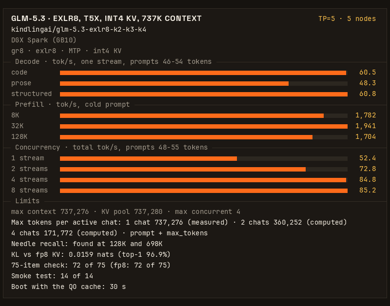

# KindlingAI: GLM-5.3 EXLR8 on five DGX Sparks (T5X, 737K context)

If you are an agent booting this for someone, read [AGENTS.md](AGENTS.md) first, then the Quickstart.

_**Join our discord to learn more about KindlingAI and `gr8`: https://discord.gg/8EAvYPV2rE**_

Full GLM-5.3 on five DGX Sparks (GB10, 128 GB each) at TP=5, served by [gr8](https://github.com/kindlingai/gr8) from
[kindlingai/glm-5.3-exlr8-k2-k3-k4](https://huggingface.co/kindlingai/glm-5.3-exlr8-k2-k3-k4), with the T5X settings:
a 737,280-token int4 KV pool, four chats at once, and a QO cache that cuts the boot to under a minute. This recipe is the
published gr8 image, pinned by digest, and one `.env` file. Nothing is compiled.



60.5 tok/s for one request writing code · 1,941 tok/s prefill on a 32K prompt · 4 requests at once, 84.8 tok/s in
total · a 737,280-token KV pool · a fact hidden in a 698K prompt found · boot in 30 s

## Results

Five DGX Sparks on one switch, TP=5, this recipe's `.env` (int4 KV, the default) under Docker Compose on the gr8 image
`sha-a555ee2` (one commit before the pinned v1.0; see [Engine pin](#engine-pin)), measured 2026-11-11 with gr8's own benchmark (`bench/bench.py`, default level), one boot.
GPU clocks were uncapped in the timed stages. Every speed is in tokens per second (tok/s).

One request, short prompts (46-54 tokens, up to 512 tokens out, 6 runs each):

| work | code | prose | structured | counting |
|---|---|---|---|---|
| tok/s, mean | 60.5 | 48.3 | 60.8 | 62.0 |
| 95% interval | 59.3 - 61.8 | 46.6 - 49.8 | 60.5 - 61.1 | 61.7 - 62.3 |

Prefill, cold prompt (one run each):

| prompt | first token | prefill tok/s | decode after it | first token, same prompt again (cached) |
|---|---|---|---|---|
| 8K tokens | 4.6 s | 1,782 | 37.3 tok/s | 0.19 s |
| 32K tokens | 16.8 s | 1,941 | 35.2 tok/s | 0.19 s |
| 128K tokens | 76.8 s | 1,704 | 32.5 tok/s | 0.37 s |

Requests at once (short mixed prompts, 48-55 tokens, up to 512 tokens out each):

| requests at once | 1 | 2 | 4 | 8 |
|---|---|---|---|---|
| total tok/s | 52.4 | 72.8 | 84.8 | 85.2 |
| tok/s per request | 53.0 | 39.6 | 26.1 | 25.8 |
| first token, median | 0.39 s | 0.68 s | 1.43 s | 7.4 s |

Four chats decode at once (`SESS=4`). With eight requests, four wait for a slot: that is the 7.4 s first token.

Checks on the same boot:

| check | result |
|---|---|
| smoke test | 14 of 14 |
| fact hidden in a 131,213-token prompt | found |
| fact hidden in a 698,500-token prompt (a separate request on the same boot) | found; first token after 630 s |
| count to 200, three times | 3 of 3 clean |
| KL against the fp8 KV format, 4,096 positions | mean 0.0159, top-1 agreement 96.9% |
| 75-item quality check (code, math, prose) | 72 of 75; the fp8 KV format scored 72 of 75 on the same boxes that night |
| longest context (`max_model_len`) | 737,276 tokens |
| boot to `/health` 200 with the QO cache | 30 s (model already on disk) |
| lowest `MemAvailable` recorded on any box, 698K prompt included | 2.82 GiB |

The boot that writes the QO cache took 99 s and 104 s (two boots, both with fp8 KV, [below](#fp8-kv-the-rollback)).
The int4 boot read the cache that an fp8 boot wrote.

### How long each chat can be

The KV pool holds 737,280 tokens. The first 4,096 tokens of each chat are stored on every box, and the rest is spread
over the five boxes. So the limit for each chat (prompt plus `max_tokens`) depends on how many chats are active:

| active chats | 1 | 2 | 4 |
|---|---:|---:|---:|
| tokens per chat, equal split | 737,276 | 360,252 | 171,772 |

The 1-chat value is the served `max_model_len`; the longest prompt that was run is 698,500 tokens. The 2-chat and
4-chat values are computed from the pool size (2,355 pages of 64 tokens per box, from the boot log), not measured.
`SESS=4`: a fifth chat waits. A finished chat's cached prefix does not count against active chats.

int4 KV stores the attention latent in 4 bits: a row is 416 bytes, against 656 with fp8. The pool is 20% larger and
uses less memory (7.0 GB a box with the MTP pool, against 8.5 GB).

### fp8 KV (the rollback)

`.env.example` has two commented lines (`KV_FORMAT=fp8`, `CAP=617536`) that give the earlier KV format. Measured
2026-11-11 on the same image and boxes, one boot, the same benchmark, with this repo's `compose.yaml`:

| measure | fp8 KV |
|---|---|
| one request: code / prose / structured / counting | 61.9 / 48.8 / 61.8 / 63.1 tok/s |
| prefill, cold 8K / 32K / 128K | 1,774 / 1,878 / 1,743 tok/s |
| 1 / 2 / 4 / 8 requests at once, total | 56.1 / 69.8 / 81.6 / 87.0 tok/s |
| longest context (`max_model_len`) | 617,532 tokens |
| tokens per chat with 1 / 2 / 4 active chats | 617,532 / 300,412 / 142,012 (2 and 4 computed from 1,981 pages a box) |
| boot to `/health` 200: first boot (writes the QO cache) / later boots | 99 s / 28 s |
| lowest `MemAvailable` recorded on any box | 1.97 GiB; 1.78 GiB on a second fp8 boot that night |

### Earlier measurements (October 2026)

T5X was first measured on 2026-10-19 on a pre-release TP=5 build of gr8, on bare metal, with the GPU clock capped at
2000 MHz and a steering profile loaded (this recipe ships none). These rows have no match in the benchmark above:

| measure | value |
|---|---|
| first token, 157K prompt | 115.8 s (mean of 2) |
| decode at 157K context | 24.5 tok/s |
| 90K chat decode: 1 chat / 4 chats total | 25.8 / 44.1 tok/s (means of 2) |
| 15 minutes of mixed agent load | 107 requests, 0 errors |
| 4 chats of 139K at once | all resident, next-turn first token 5.0-5.6 s |
| fact hidden at 437K | found |

[kindling.json](kindling.json) has the card's numbers in a form a program can read.

## Quickstart

On every box, first turn off proactive memory compaction and open TCP ports 7340 and 7341 between the boxes
([What you need](#what-you-need)). Then, on every box:

```bash
git clone https://github.com/kindlingai/glm-5.3-exlr8-5x-spark && cd glm-5.3-exlr8-5x-spark
sudo mkdir -p /srv/gr8/cache/qocache && sudo chown -R 1000:1000 /srv/gr8/cache
cp .env.example .env
nano .env                  # PEERS: the five LAN addresses, head first. The same file on every box.
docker compose up -d       # pulls the pinned gr8 image; the first boot fetches this box's part of the model
docker compose logs -f     # this box's supervisor; ready when the cluster serves
```

The first boot also writes the QO cache (13 GB a box) to `/srv/gr8/cache/qocache`. Later boots read it. The engine
does not make that directory: without the `mkdir` line no cache is written, and every boot takes the long time.
For another place, change `GR8_CACHE` in `.env` and make its `qocache` directory the same way.

Then, on the head (the first address in `PEERS`):

```bash
docker compose exec gr8 /opt/gr8/gr8 glm53 smoke
curl -s localhost:8100/v1/models      # max_model_len 737276
```

The head serves an OpenAI-compatible API on port 8100. Stop the cluster with
`docker compose exec gr8 /opt/gr8/gr8 glm53 down` on the head, then `docker compose down` on every box.

## What you need

- Five DGX Sparks or other GB10 boxes (128 GB unified memory), with nothing else holding much memory. The lowest
  `MemAvailable` measured was 2.82 GiB (1.78 GiB with fp8 KV), so a box runs this model and nothing else.
- A RoCE v2 fabric between the ConnectX-7 ports through one 200G switch. Five boxes do not work as a ring.
- A LAN between the boxes with TCP ports 7340 and 7341 open.
- Docker with the NVIDIA container toolkit (DGX OS has both).
- About 90 GB of disk a box for the model and 13 GB for the QO cache.
- Proactive memory compaction off on every box:
  `sudo sysctl -w vm.compaction_proactiveness=0` (gr8's
  [DEPLOY.md](https://github.com/kindlingai/gr8/blob/main/docs/DEPLOY.md#before-you-start) has the permanent form).

## What T5X is

T5X is the decode settings of gr8's four-box setup, plus five settings measured at TP=5 (`GR8_K1_TLBW=2048`,
`PF_GEMMF32=1`, `ATTN_CTX3=4`, `PF_ISGRT_RG=32`, `PF_ATTN_ROWS=512`), plus:

- `PF_OWN=3` with `QO_CACHE`: the boot took 30 s with the cache and 99-104 s on the boots that wrote it.
- `KV_FORMAT=int4` with `CAP=737280`, and five `GR8_KV4_*` settings in `EXTRA_ENV` for the int4 attention kernels.
- `KVB=fp8`, `MTP=2`, `SESS=4`, `SHARE_LIMIT=4096`.

Every line is in [.env.example](.env.example). gr8's
[SETTINGS.md](https://github.com/kindlingai/gr8/blob/main/docs/SETTINGS.md) explains each setting.

Tried at TP=5 in October 2026, on the pre-release build, and left off:

| setting | what happened |
|---|---|
| `GR8_L2PF` | 0.4 GB less free memory, no gain under mixed load |
| `PF_OWNPERM=1` | the output changes (prefill KL 0.0031), 8K prefill 6.7% slower |
| `QA_SPLIT=2` | 32K prefill 5% slower |
| `SHARE_LIMIT=8192` | the fourth 128K chat is evicted, 90K decode 4% slower |

`KV_FORMAT=int4` was also tried then, with `CAP=810496`: 1 to 4% slower, and left off. gr8 has faster int4 kernels
since; on the `sha-a555ee2` image int4 is this recipe's default, at `CAP=737280` ([Results](#results)).

## Option: remote KV on a sixth Spark (experimental)

The two commented lines at the end of `.env.example` (`KV_STORE=remote:...` and `KV_KEEP=sessions`) send the KV of
evicted chats to a sixth Spark, which runs `gr8 kv up --gb 106` and keeps them in its RAM. A chat that comes back
reads its blocks over RDMA and needs no new prefill.

This was measured on 2026-10-20 as test runs on a pre-release build. It was never run as a long serve.

- 10 chats of about 22K on a reduced pool, 30 requests per arm: median first token on restore 2.03 s with the store,
  14.24 s without it. Outputs equal 30 of 30.
- On the full T5X settings: 8K / 32K prefill 1,570 / 1,545 tok/s and prose decode 39.5 tok/s (inside the noise of
  the October numbers for the same build: 1,572 / 1,569 / 39.8). A fact hidden at 500,460 tokens was found. Lowest free memory 2.45 GB.
- 4 chats of about 97.5K, pushed out of the pool by a 355K prompt, came back from the sixth box with a first token
  in 1.26-5.51 s. A full prefill takes about 67 s.
- Limits: the sixth box locks 106 GiB of RAM; five boxes share its one 200G port; the store is empty after a
  restart.

## Engine pin

This recipe has no engine code. It runs one published gr8 image, named by tag and digest in
[compose.yaml](compose.yaml) and in the `engine` field of [kindling.json](kindling.json):

| | |
|---|---|
| engine | [kindlingai/gr8](https://github.com/kindlingai/gr8) [`v1.0`](https://github.com/kindlingai/gr8/releases/tag/v1.0) at [`db6f2c1`](https://github.com/kindlingai/gr8/commit/db6f2c17c7b05303b69ce667e416d10340aeb9b7) |
| image | `ghcr.io/kindlingai/gr8:sha-db6f2c1` |
| digest | `sha256:d6a054f681e999ae25b95c5bff7c831950dd98b70bf20f480d45a111a86f6925` |

The results above were measured on the image of gr8 commit [`a555ee2`](https://github.com/kindlingai/gr8/commit/a555ee2a078946332769b5cd412ba3c73c46e242) (`ghcr.io/kindlingai/gr8:sha-a555ee2`). v1.0 is one commit after it, and that commit changes only the README, the docs, the benchmark tools and their result files, not the engine source. This recipe was not booted again on the v1.0 image.

After v1.0, the pin moves to a newer gr8 release only after this recipe was booted and measured on it. `python3 check.py` checks
that `compose.yaml` and `kindling.json` name the same image; CI runs it on every pull request.

For five boxes with gr8's own defaults (502,848-token pool, eight chats), use
[glm-5.3-exlr8-4x-spark](https://github.com/kindlingai/glm-5.3-exlr8-4x-spark) with five addresses in `PEERS`.
For six boxes, see [glm-5.3-exlr8-6x-spark](https://github.com/kindlingai/glm-5.3-exlr8-6x-spark).

## License

MIT, see [LICENSE](LICENSE). GLM-5.3 has its own licence: see the
[model page](https://huggingface.co/kindlingai/glm-5.3-exlr8-k2-k3-k4).
